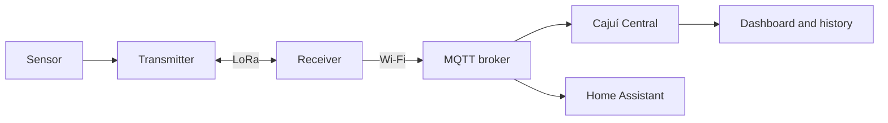

# Cajuí

English | [Português brasileiro](README.pt-BR.md)

**A wireless sensor network built from off-the-shelf ESP32/LoRa boards: battery-powered
measurement points, a single board as the receiver, and your readings kept on your
own computer.**

A Cajuí transmitter is a Heltec board with a sensor and a battery. Every five minutes
it wakes up, reads the sensor, sends the measurement over LoRa and goes back to sleep.
The receiver is another board from the same family, connected to Wi-Fi: it receives
the measurements from every transmitter and hands them to an MQTT broker on your
network. From there, Cajuí Central keeps the history and shows the dashboard, or
Home Assistant consumes the data directly. Collection and monitoring stay on your
network, with no cloud service involved.

The radio uses its own protocol, point to point between transmitters and the
receiver. That is why one of these boards, running the Cajuí firmware, is enough to
receive: there is no LoRaWAN gateway or network server in the path.

Today the reference firmware reads temperature and humidity (SHT4x or DHT22/AM2302)
on two Heltec boards. It is the first complete example, from sensor to dashboard.

[Try Central](#try-the-dashboard-without-boards) · [Build a sensor link](#build-your-first-sensor-link) ·
[Read the guides](#documentation) · [Contribute](#contributing)

**Cajuí is experimental.** Assembly and firmware installation still require
technical work, and the limits in the next section apply to any installation.

## Where the project is heading

The architecture was designed for a general-purpose sensor network, not only for
climate. Three goals guide development:

- other sensor types, such as soil moisture, water level and rainfall;
- several sensors on the same transmitter;
- months of battery life between charges.

None of the three is ready. Each transmitter reads one climate sensor; another
sensor needs a driver and application support; real battery life has not been
measured yet and depends on the board, sensor, battery and reporting interval.
Range and network capacity have not been established either. The
[project status](docs/en/status.md) separates what is implemented, what still needs
validation and what does not exist yet.

## What each part does

| Part | What it does |
| --- | --- |
| Sensor | Measures a physical quantity and connects to a transmitter through a supported interface. |
| Transmitter | Reads the sensor and sends measurements over LoRa. It can sleep between readings. |
| Receiver | Accepts enrolled transmitters, acknowledges radio messages and forwards samples over Wi-Fi. |
| MQTT broker | Routes messages to subscribed applications. Central's Docker setup includes one. |
| Cajuí Central | Stores readings, shows a dashboard and history, and helps diagnose devices. |
| Home Assistant | An alternative consumer of the receiver's MQTT data; Central is optional. |

Broker and Central can run on the same computer; they must remain running to
receive and store new data. Central's current interface is restricted to the local
computer because it has no user authentication.

## Try the dashboard without boards

[Cajuí Central](https://github.com/cajui/cajui-central#try-it-without-hardware) includes
a Docker Compose setup and a simulated sample. Start it, register the demo device,
and explore the dashboard and history before assembling hardware.

The interface supports English and Brazilian Portuguese. You can name devices and
sensors, organize measurements into sections, and distinguish sensor failures from
devices that stopped reporting. Read the [Central guide](docs/en/central.md) for
history, status and administration behavior.

## Build your first sensor link

Start with one receiver and one transmitter:

| You need | Current reference setup |
| --- | --- |
| Receiver | Heltec WiFi LoRa 32 V3 with a suitable LoRa antenna |
| Transmitter | Heltec WiFi LoRa 32 V3 with DHT22/AM2302, or Wireless Stick Lite V3 with SHT4x; also needs an antenna |
| Power and wiring | Power for both boards, a USB data cable and sensor wiring appropriate to its supply and interface |
| Network | 2.4 GHz Wi-Fi for the receiver and a reachable MQTT broker |
| Monitoring | A computer running Central, or an existing Home Assistant installation with MQTT |

1. Check [board compatibility and wiring](docs/en/components.md).
2. Follow [installation](docs/en/setup.md): prepare the broker, install the correct
   firmware, configure receiver networking and enroll the transmitter.
3. Confirm that a reading reaches the application, then name the device and sensor.
4. Check reception and recovery at the intended location using the
   [operations guide](docs/en/operations.md).

Each reference transmitter reads one climate sensor. Adding other sensor models
requires firmware support. Match frequency, power and antenna to your region.
The open setup access point, plaintext MQTT and radio-pairing limitations described
in [radio and security](docs/en/radio-security.md) require a trusted setup environment.

## Repositories

| Repository | Start here when you want to… |
| --- | --- |
| [cajui-central](https://github.com/cajui/cajui-central) | Run the dashboard, work on the application, or integrate an HTTP/MQTT producer |
| [cajui-firmware](https://github.com/cajui/cajui-firmware) | Install board firmware, add sensor support, or study the radio protocol |
| [docs](https://github.com/cajui/docs) | Understand the complete system, installation and operation |

## Documentation

| Guide | Contents |
| --- | --- |
| [Architecture](docs/en/overview.md) | Topology, services and the path of a measurement |
| [Components](docs/en/components.md) | Boards, power, antennas and sensor interfaces |
| [Installation](docs/en/setup.md) | From firmware and broker setup to the first reading |
| [Cajuí Central](docs/en/central.md) | Dashboard, history, registration and device status |
| [MQTT and integrations](docs/en/mqtt-integrations.md) | Broker permissions, Home Assistant and discovery |
| [Operations](docs/en/operations.md) | Diagnose missing readings, update and recover |
| [Data flow](docs/en/data-flow.md) | Acknowledgements, buffering and delivery limits |
| [Radio and security](docs/en/radio-security.md) | Pairing, encryption and trust boundaries |
| [Feature inventory](docs/en/inventory.md) | Capabilities and their implementation status |
| [Development](docs/en/development.md) | Source organization and tests |
| [Glossary](docs/en/glossary.md) | Terms and abbreviations |
| [Status and compatibility](docs/en/status.md) | Documented revisions and validation still needed |

## Contributing

Try the setup instructions and report where they fail or leave a step unclear.
Documentation fixes and translations belong here; firmware and application changes
belong in their respective repositories. See [CONTRIBUTING.md](CONTRIBUTING.md)
for editing and validation. Keep English and Brazilian Portuguese pages in sync.

## License

This documentation is licensed under [Apache-2.0](LICENSE).
