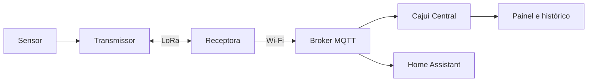

# Cajuí

[English](README.md) | Português brasileiro

**Monte uma rede de sensores de baixo consumo com placas LoRa comuns, sem precisar de um gateway comercial.**

O Cajuí é um projeto open source para redes locais de sensores. A proposta é
conectar diferentes tipos de sensor, inclusive vários no mesmo transmissor, e
reunir suas medições em uma receptora feita com uma única placa ESP32/LoRa
compatível. Você pode acompanhar os dados no Cajuí Central ou usar MQTT com o
Home Assistant ou sua própria aplicação.

## Por que Cajuí?

- **Uma receptora que você pode montar.** Uma placa LoRa compatível cuida da
  recepção; não é necessário um gateway comercial ou servidor de rede LoRaWAN.
- **Pontos de medição a bateria.** Os transmissores dormem entre leituras.
  O objetivo é passar meses entre recargas em medições periódicas. A autonomia
  real ainda precisa ser medida e depende da placa, dos sensores, da bateria,
  do intervalo de envio e das condições do rádio.
- **Espaço para diferentes sensores.** Atender vários sensores por transmissor
  faz parte da direção do projeto. Hoje, o firmware de referência lê um sensor
  de clima DHT22/AM2302 ou SHT4x por transmissor; outros tipos e combinações
  precisam de suporte nos drivers e na aplicação.
- **Operação local.** Apenas a receptora precisa de Wi-Fi. Ela encaminha os dados
  a um broker MQTT na sua rede, sem exigir assinatura de nuvem para coleta ou
  monitoramento.

Temperatura e umidade são o primeiro exemplo em funcionamento. O projeto serve
como base para ampliar o monitoramento, incluindo umidade do solo, nível de água
ou chuva, conforme o suporte a esses sensores for adicionado.

[Experimente o Central](#experimente-o-painel-sem-placas) · [Monte um enlace de sensores](#monte-seu-primeiro-enlace-de-sensores) ·
[Leia os guias](#documentação) · [Contribua](#contribuições)

**O Cajuí é experimental.** As aplicações de referência atendem sensores de
temperatura e umidade em placas Heltec específicas. Montagem e instalação do
firmware ainda exigem trabalho técnico. Alcance, autonomia e capacidade da rede
não foram estabelecidos para instalações em geral. Consulte o
[estado e a compatibilidade](docs/pt-BR/status.md).

## O que cada parte faz

| Parte | Função |
| --- | --- |
| Sensor | Mede uma grandeza física e se conecta ao transmissor por uma interface compatível. |
| Transmissor | Lê o sensor e envia medições por LoRa. Pode dormir entre leituras. |
| Receptora | Aceita transmissores pareados, confirma mensagens de rádio e encaminha amostras por Wi-Fi. |
| Broker MQTT | Distribui mensagens às aplicações inscritas. A instalação Docker do Central inclui um. |
| Cajuí Central | Armazena leituras, apresenta painel e histórico e ajuda no diagnóstico dos dispositivos. |
| Home Assistant | Consome os dados MQTT da receptora como alternativa; o Central é opcional. |

A receptora é uma placa ESP32/LoRa compatível executando o firmware Cajuí. O enlace
usa um protocolo próprio de LoRa direto, não LoRaWAN. Ele não exige gateway nem
servidor de rede LoRaWAN. Broker e Central podem rodar no mesmo computador; precisam
continuar ligados para receber e armazenar novos dados. A interface atual do Central
é restrita ao computador local porque ainda não tem autenticação de usuários.

## Experimente o painel sem placas

O [Cajuí Central](https://github.com/cajui/cajui-central/blob/main/README.pt-BR.md#experimente-sem-hardware)
inclui uma instalação com Docker Compose e uma amostra simulada. Inicie o sistema,
cadastre o dispositivo de demonstração e explore o painel e o histórico antes
de montar o hardware.

A interface oferece português brasileiro e inglês. Você pode nomear dispositivos
e sensores, organizar medições em seções e distinguir falhas de sensor de
dispositivos que pararam de enviar. O [guia do Central](docs/pt-BR/central.md)
explica histórico, estados e administração.

## Monte seu primeiro enlace de sensores

Comece com uma receptora e um transmissor:

| Você precisa de | Montagem de referência atual |
| --- | --- |
| Receptora | Heltec WiFi LoRa 32 V3 com antena LoRa adequada |
| Transmissor | Heltec WiFi LoRa 32 V3 com DHT22/AM2302 ou Wireless Stick Lite V3 com SHT4x; também precisa de antena |
| Alimentação e ligação | Alimentação para as duas placas, cabo USB de dados e ligação do sensor adequada à sua tensão e interface |
| Rede | Wi-Fi de 2,4 GHz para a receptora e um broker MQTT acessível |
| Monitoramento | Computador executando o Central ou uma instalação existente do Home Assistant com MQTT |

1. Confira a [compatibilidade e a ligação das placas](docs/pt-BR/components.md).
2. Siga a [instalação](docs/pt-BR/setup.md): prepare o broker, instale o firmware
   correto, configure a rede da receptora e cadastre o transmissor.
3. Confirme a chegada de uma leitura à aplicação e nomeie o dispositivo e o sensor.
4. Confira recepção e recuperação no local de uso com o [guia de operação](docs/pt-BR/operations.md).

Cada transmissor de referência lê um sensor de clima. Outros modelos de sensor
exigem suporte no firmware. Adeque frequência, potência e antena à sua região.
O ponto de acesso aberto, o MQTT sem criptografia de transporte e os limites do
pareamento descritos em [rádio e segurança](docs/pt-BR/radio-security.md) exigem
um ambiente confiável para configuração.

## Repositórios

| Repositório | Comece aqui para… |
| --- | --- |
| [cajui-central](https://github.com/cajui/cajui-central) | Executar o painel, trabalhar na aplicação ou integrar um produtor HTTP/MQTT |
| [cajui-firmware](https://github.com/cajui/cajui-firmware) | Instalar o firmware, adicionar suporte a sensores ou estudar o protocolo de rádio |
| [docs](https://github.com/cajui/docs) | Entender o conjunto, a instalação e a operação |

## Documentação

| Guia | Conteúdo |
| --- | --- |
| [Arquitetura](docs/pt-BR/overview.md) | Topologia, serviços e caminho de uma medição |
| [Componentes](docs/pt-BR/components.md) | Placas, alimentação, antenas e interfaces dos sensores |
| [Instalação](docs/pt-BR/setup.md) | Do firmware e broker à primeira leitura |
| [Cajuí Central](docs/pt-BR/central.md) | Painel, histórico, cadastro e estado dos dispositivos |
| [MQTT e integrações](docs/pt-BR/mqtt-integrations.md) | Permissões, Home Assistant e descoberta |
| [Operação](docs/pt-BR/operations.md) | Diagnosticar leituras ausentes, atualizar e recuperar |
| [Fluxo de dados](docs/pt-BR/data-flow.md) | Confirmações, filas e limites de entrega |
| [Rádio e segurança](docs/pt-BR/radio-security.md) | Pareamento, criptografia e limites de confiança |
| [Inventário de funções](docs/pt-BR/inventory.md) | Capacidades e estado da implementação |
| [Desenvolvimento](docs/pt-BR/development.md) | Organização do código e testes |
| [Glossário](docs/pt-BR/glossary.md) | Termos e abreviações |
| [Estado e compatibilidade](docs/pt-BR/status.md) | Revisões documentadas e validações pendentes |

## Contribuições

Experimente as instruções e relate onde elas falham ou deixam uma etapa pouco
clara. Correções de documentação e traduções ficam aqui; mudanças no firmware
e na aplicação pertencem aos respectivos repositórios. Consulte
[CONTRIBUTING.pt-BR.md](CONTRIBUTING.pt-BR.md) para editar e validar. Mantenha as
páginas em inglês e português brasileiro sincronizadas.

## Licença

Esta documentação está sob a [Apache-2.0](LICENSE).
